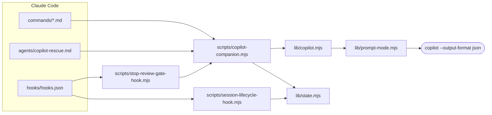
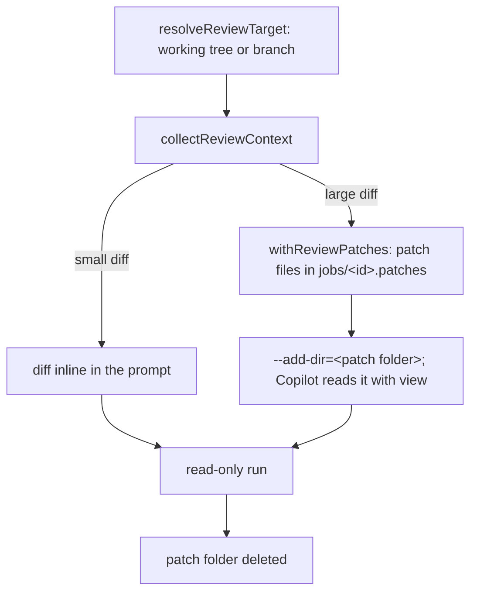
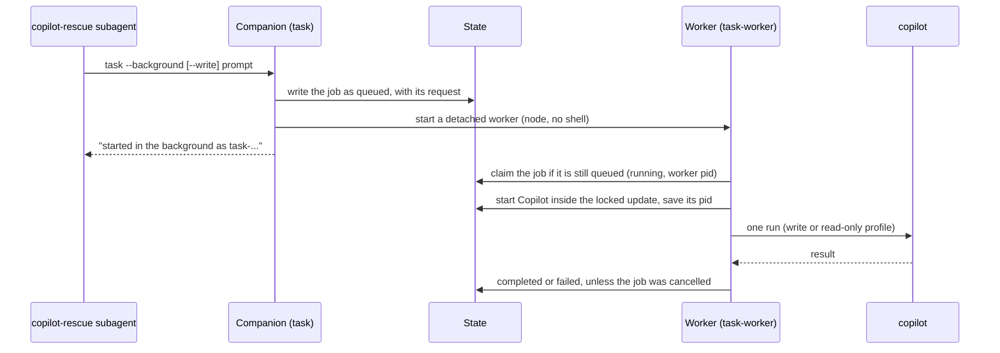
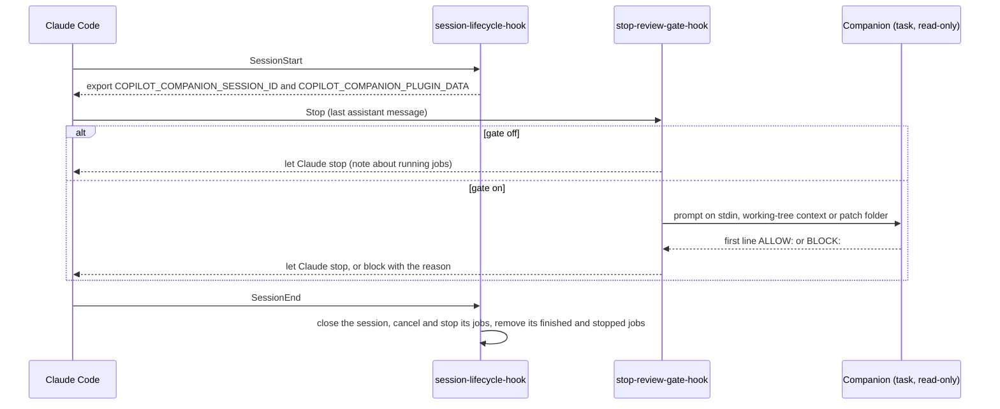

# Architecture

How the plugin is built. Paths are relative to `plugins/copilot/`. The Copilot flags and folders are
in [configuration.md](configuration.md). The job states, files and cancel are in
[operations.md](operations.md).

## Overview

Claude Code reads the plugin's commands, agent, skills and hooks. The commands and the agent run one
Node script, the companion. The hooks run their own scripts: the session hook works on the job state
directly, and the review gate hook starts the companion. The companion keeps the job state and calls
Copilot through one adapter module. The adapter starts one `copilot` process for each run.



## Modules

| File | What it does |
| --- | --- |
| `scripts/copilot-companion.mjs` | The entry point for every command: `setup`, `review`, `adversarial-review`, `task`, `task-worker`, `task-resume-candidate`, `status`, `result` and `cancel`. It creates the job records, collects the review context and renders the output. |
| `scripts/lib/copilot.mjs` | The adapter. It is the only module that builds Copilot arguments and environments, and that decides permissions. It checks the version and the login, runs reviews and tasks, and turns Copilot's JSON events into a result. |
| `scripts/lib/prompt-mode.mjs` | The transport helper. It starts one `copilot` process without a shell, writes the prompt to stdin and reads one JSON event per line. Only the adapter imports it. |
| `scripts/lib/prompt-mode-protocol.d.ts` | Types for Copilot's JSON events, written by hand. `npm run build` checks them. |
| `scripts/lib/process.mjs` | Runs commands without a shell, finds the Windows `.cmd` launchers (`resolveLauncher`) and stops process trees (`terminateProcessTree`). |
| `scripts/lib/git.mjs` | Finds the review target and collects the diff with safe `git` options. Writes the patch files for a large review. |
| `scripts/lib/state.mjs` | Job state and job files. Changes to `state.json` hold a lock. The state and the job files are each replaced through a temp file and a rename, so a reader never sees half a file. |
| `scripts/lib/tracked-jobs.mjs` | Runs a job: marks it `running`, writes progress to its log and saves the final status. |
| `scripts/lib/job-control.mjs` | Finds the jobs for `status`, `result` and `cancel`. |
| `scripts/lib/render.mjs` | Turns setup reports, reviews, task results and job lists into Markdown. |
| `scripts/lib/args.mjs`, `prompts.mjs`, `fs.mjs`, `workspace.mjs` | Argument parsing, prompt templates, file helpers and the workspace folder. |
| `scripts/session-lifecycle-hook.mjs` | `SessionStart` exports the Claude session id and the plugin data folder (`COPILOT_COMPANION_PLUGIN_DATA`) for the commands. `SessionEnd` cancels the session's jobs and removes them, except a job whose processes could not be stopped, which stays for `/copilot:cancel`. |
| `scripts/stop-review-gate-hook.mjs` | The `Stop` hook. When the review gate is on, it runs a read-only Copilot review of the last turn and can block the stop. |
| `prompts/*.md` | Prompt templates for the review, the adversarial review and the review gate. |
| `schemas/review-output.schema.json` | The answer format of the adversarial review. |

## One Copilot run

Every review, task and login check is one run. The adapter builds the arguments and the environment
from a permission profile, and the transport helper starts the process.

```mermaid
sequenceDiagram
  participant C as Companion
  participant A as Adapter (copilot.mjs)
  participant T as Transport (prompt-mode.mjs)
  participant P as copilot process
  C->>A: runPromptModeReview or runPromptModeTurn
  A->>A: buildCopilotArgs and buildCopilotEnv (read-only or write profile)
  A->>T: start(command, args, env, prompt)
  T->>P: spawn without a shell (its own process group on macOS and Linux)
  T->>P: prompt on stdin, then close stdin
  loop one JSON event per line
    P-->>T: event
    T-->>A: event
    A->>A: record answer, reasoning and tools; report progress
    A->>A: stop the run if a read-only run starts a tool that is not allowed
  end
  P-->>T: result event
  T->>P: stop the process tree if it is still alive 5 seconds later
  T-->>A: exit code, signal, stderr
  A-->>C: status, answer, session id, touched files
```

- The `result` event decides the outcome. A run without one fails with the process exit code.
- A line that is not JSON stops the run. The error quotes the line.
- When the companion gets `SIGTERM` or `SIGINT`, it stops its Copilot process tree first.

## Reviews

`review` and `adversarial-review` collect the diff themselves, because the read-only profile gives
Copilot no shell.



- `review` sends Copilot's `/review` command with the context.
- `adversarial-review` puts the answer schema in the prompt. The adapter parses the answer, also
  inside one code fence, and checks it against the schema. An answer that does not match fails the
  job.

## Tasks and background jobs

`/copilot:rescue` goes through the `copilot-rescue` subagent to the companion's `task` command.



- A job that was cancelled, or whose Claude session has ended, is never claimed and never started.
- `--resume` continues the newest finished task of the same mode, with `--resume=<session id>`.
- `cancel` marks the job `cancelled` in one locked update, then stops the worker and the Copilot
  process at the same time. See [operations.md](operations.md#cancel).

## Hooks



- The gate's run stops 14 minutes after the hook starts. Then the hook stops the companion's process
  tree and marks the job `cancelled`, inside Claude Code's 15-minute hook limit.
- When the gate is on and its review cannot run, the hook blocks the stop and says why.

## Job state

The states and the transitions are in [operations.md](operations.md#job-states). Every change goes
through `updateState`, which holds `state.json.lock` for the whole read, change and write. Pruning
never removes a queued or running job.
